<div align="center">




<a href="https://miguel-kappa.vercel.app"></a> <a href="https://linkedin.com/in/miguel-lima-845666252"></a> <a href="mailto:miguellima23260923@gmail.com"></a> 

</div>

<br/>

```yaml
whoami:
  role:     Support Analyst & Developer @ Woli Tecnologia   # 3 anos
  where:    Araxá, MG 🇧🇷
  degree:   Sistemas de Informação — UNIARAXÁ
  do:       [servidores Linux, Docker, CI/CD, APIs, full stack Node + Vue, IA local]
  shipped:  160+ PRs mergeados em 6 meses (Bitbucket da empresa)
  learning: [C#, cibersegurança, LLMs & RAG, fine-tuning, LPIC-1]
```

<br/>

### `~/stack`

<div align="center">


</div>

<br/>

### `~/projects`

| | projeto | stack | o que faz |
|:-:|---|---|---|
| `01` | **WOLi Inventory** | Node · Vue · MySQL · Docker | SaaS B2B de gestão de ativos de TI — equipamentos, garantias, salas, NF-e |
| `02` | **WoliChat** | Ollama · Node · Nginx | Chat 100% local com Qwen3 — tool-calling, RAG e MCP |
| `03` | **woli-guard** | Go · Docker | Agente de monitoramento de frota (CPU, RAM, GPU, IP) + dashboard |
| `04` | **[Toolkit](https://apptoolkit.vercel.app)** | Next · Fastify · Prisma | Catálogo de apps/drivers que gera scripts de instalação + [CLI no npm](https://www.npmjs.com/package/@migueltoolkitdev/toolkit-cli) |
| `05` | **[EngCalc](https://github.com/miguellima2326/FACULDADE-EngCalc)** | TypeScript | Site de cálculos de engenharia |

<br/>

### `~/stats`

<div align="center">




<br/><br/>

<picture>
  <source media="(prefers-color-scheme: dark)" srcset="https://raw.githubusercontent.com/miguellima2326/miguellima2326/output/snake-green-dark.svg"/>
  
</picture>

</div>

<br/>


